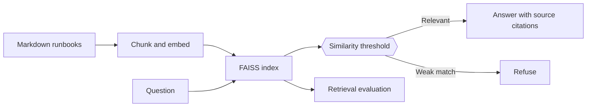

# Runbook RAG

[](https://github.com/Darpen24/runbook-rag/actions/workflows/ci.yml)

[](LICENSE)

Retrieval-augmented runbook search with FAISS, cited answers and retrieval evaluation.

This portfolio project demonstrates markdown runbooks → overlapping chunks → embeddings → faiss → cited answers. A reproducible offline demo and synthetic fixtures let reviewers inspect the behavior without credentials. See [design notes](docs/design-notes.md) for implementation details, evaluation methodology and limitations.

## Quick start

Requires Python 3.10 or newer; Python 3.12 was used for local validation. Clone this repository, then:

```bash
git clone https://github.com/Darpen24/runbook-rag.git
cd runbook-rag
python -m venv .venv
# macOS / Linux
source .venv/bin/activate
# Windows PowerShell (use this instead)
# .\.venv\Scripts\Activate.ps1
python -m pip install -e ".[dev]"
python -m runbook_rag ingest
python -m runbook_rag ask "What does error code 809 mean on the VPN?"
python -m runbook_rag eval
python -m pytest -q
```

The installed command `runbook-rag` is also available. No `PYTHONPATH` setup is required.

## Architecture



The bundled demo data and prompts live in `src/runbook_rag/resources/`. Root `data/` and `prompts/` (where present) preserve the original fixtures; use the environment overrides to point at those when editing them.

## Explore the code

| Location | Purpose |
|---|---|
| `src/runbook_rag/` | Application logic and command line interface |
| `tests/` | Behavior and regression checks |
| `docs/design-notes.md` | Design choices, original implementation notes and limits |
| `docs/demo-output.txt` | Output captured from a verified offline run |
| `.github/workflows/ci.yml` | Automated lint, tests, package build and demo |

## Verified offline results

| Metric | Result |
|---|---|
| Answerable questions | 12 |
| Hit rate at 3 | 1.000 |
| Mean reciprocal rank | 0.958 |
| Out of scope refusals | 2 / 2 |
| Tests | 8 passed |

## Configuration and scope

Defaults run offline using a deterministic stub, which is not a language model. Copy `.env.example` to `.env` in the working directory to configure a provider. Existing environment variables take precedence. Install a provider extra with `pip install -e ".[openai]"` or `pip install -e ".[anthropic]"`. Live providers were not validated and require your own credentials.

Set `DOC_DIR` to use your own Markdown documents and `INDEX_DIR` to choose the index location. Rebuild the index after changing embeddings. Similarity thresholds depend on the embedding model.

Demo metrics describe a small synthetic fixture, not production performance. See the captured output and design notes before interpreting results.

## Development

```bash
ruff check .
python -m pytest -q
python -m build
```

See [contributing](CONTRIBUTING.md), [security](SECURITY.md), and [changes added during repository preparation](ADDITIONS.md). Licensed under [MIT](LICENSE).
